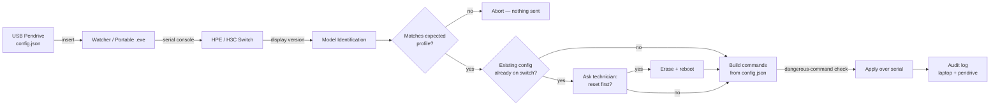

# 🔌 H3C/HPE Switch Auto-Configure Bot

> A pendrive-triggered automation tool that identifies a network switch over its console port and configures it automatically — no typed commands, no guesswork about what hardware is on the other end of the cable.

**Status:** Private repository — source code available on request (interviews, technical review, collaboration).

---

## What it does

1. A network technician plugs a USB pendrive containing a site's config (VLANs, IP addressing, ports, routes) into a laptop already wired into a switch's console port.
2. The tool detects the drive, connects over serial, and reads `display version` from the switch to confirm it's actually talking to the expected model — before it ever sends a configuration command.
3. It checks whether the switch already has a configuration. If it's factory-blank, it configures automatically. If it already has something on it, it asks the technician whether to erase and start fresh first — a real decision point, not a silent overwrite.
4. It builds and sends the switch commands, blocks anything on a dangerous-command list (reboot, factory reset, etc. from the generated set), and writes a full audit log of every command sent and every response received — both on the laptop and back onto the pendrive itself.
5. A one-shot lockout means the same pendrive can be left plugged in without reapplying the same config twice.

The goal was to take a repetitive, error-prone manual CLI workflow (console into a switch, type 20–30 commands by hand, per site) and make it something a technician can do by plugging in a USB stick — while keeping every safety check a human would normally provide.

---

## Tech stack

**Core**
- Python 3
- PySerial — console/serial communication with the switch (RS-232 over USB-to-serial adapter)

**Automation & detection**
- Windows API (`ctypes`) — polling for removable-drive arrival, no extra dependencies
- Regex-based switch identification against `display version` output, matched to a small extensible profile registry per switch model

**Packaging**
- PyInstaller — bundled into standalone `.exe` files so a technician doesn't need Python installed; two complementary modes (an always-on watcher installed on one laptop, and a fully portable one-shot runner that ships on the pendrive itself alongside the config)

**Optional**
- Netmiko — SSH fallback for switches already reachable over the network, for the manual (non-pendrive) workflow

---

## Architecture

---

## Key engineering decisions

- **Config is data, not code.** A JSON file describes the *desired* switch state (VLANs, IPs, ports); a separate command-builder translates it into CLI syntax. Editing a site's config never requires touching the automation logic.
- **Identify before you act.** The switch's model is confirmed over the console *before* any config command is generated, using a small profile registry (`regex → known model → command overrides`) rather than assuming one hardware target forever — a second switch model is a registry entry, not a rewrite.
- **Removing the human "type APPLY" step meant adding different safeguards, not fewer.** A marker-file convention (so a random USB stick can't trigger anything), a dangerous-command blocklist, a one-shot lockout keyed on (drive serial + config hash), and mandatory logging replace the manual confirmation that a CLI tool would normally rely on.
- **The existing-configuration check is a deliberate exception to full automation.** Auto-configuring a blank switch is safe to do unattended; auto-*erasing* a switch that already has a live configuration is not — so that one case pauses and asks, everything else doesn't.
- **Two portable failure modes, worked out against real hardware.** USB-to-serial adapters need time to settle after the port opens before the switch responds; Comware's `reboot` command asks two different yes/no questions that must be answered differently; and a switch can look "back up" over serial before it's actually finished rebooting (no hangup signal on a serial line) — a naive "got a response" check isn't enough. Each of these came from an actual live test that broke, not from reading a manual.
- **Two run modes for two real deployment shapes:** an always-on watcher for a laptop that stays wired to a switch with different pendrives swapped in, and a fully portable single-file `.exe` for a technician who wants the whole toolkit — code, config, and its own audit log — to travel on one USB stick to any wired laptop.

---

## Interested in the code?

The repository is private since it's tied to a specific internal network deployment. If you'd like to see the source — the command builder, the switch-detection logic, or a walkthrough of how it handles real hardware — feel free to reach out.
